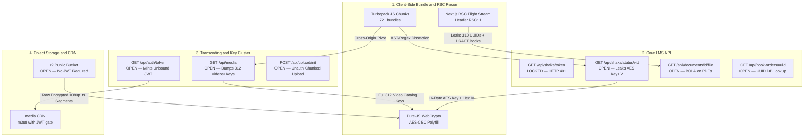

# 🛡️ Multi-Tier EdTech LMS & HLS DRM Security Research

[-0f172a?style=flat-square&logo=github)](https://github.com/TuanAnhk10)
[](https://owasp.org/API-Security/)
[](./docs/findings.md)
[](./docs/threat-model.md)
[](./pyproject.toml)
[](./tests/)
[](./LICENSE)

> **Case Study**: End-to-End Grey/Black-Box Security Assessment of a Modern Multi-Tier EdTech Platform — Chaining **Next.js App Router RSC Flight Stream Inspection**, **Spring Boot 3.2 Broken Object Level Authorization (BOLA)**, **Unauthenticated Shaka Packager Transcoding APIs**, **Cloudflare R2 Public Bucket Exposure**, and **Client-Side AES-128-CBC HLS DRM Key Injection**.

---

## 📌 Executive Overview

Modern EdTech and video-streaming platforms increasingly rely on decoupled microservice architectures: a **Next.js App Router** frontend utilizing React Server Components (RSC), a **Spring Boot** core business API, a dedicated **Shaka Packager / FFmpeg** transcoding cluster, and **Cloudflare R2 / S3** edge storage protected by **AES-128-CBC HLS encryption**.

This repository documents an end-to-end security research engagement demonstrating how **inconsistent authorization boundaries across microservices** completely neutralize cryptographic DRM protections. Specifically, while the primary playback token endpoint (`GET /api/shaka/token`) properly enforced authentication (`HTTP 401`), lateral reconnaissance across client-side Turbopack bundles and RSC streams uncovered unauthenticated sibling endpoints and upstream transcoding APIs that leaked **all 312 AES-128 encryption keys, initialization vectors (IVs), and raw 1080p MPEG-TS streams**.

> [!IMPORTANT]
> **Ethical & Redaction Notice**: All production domain names, real cryptographic keys, personally identifiable information (PII), and copyrighted educational materials have been **strictly sanitized and replaced with synthetic equivalents** (`lms.edtech-target.example`, `shaka.media-core.example`, `r2.storage-edge.example`). A self-contained, local vulnerable multi-service simulator ([`lab/mock_edtech_stack.py`](./lab/mock_edtech_stack.py)) is provided so security researchers and engineers can reproduce the entire kill chain locally and safely.

---

## 🏗️ Reconstructed Architecture & Kill Chain



---

## 🚨 Summary of Verified Findings

| ID | Vulnerability Title | OWASP API 2023 | CWE | CVSS v3.1 | Severity |
| :---: | :--- | :---: | :---: | :---: | :---: |
| **[`FIND-01`](./docs/findings.md#find-01)** | Unauthenticated Mass Exposure of Media Catalog (312 Videos) & AES-128 DRM Keys via Upstream `/api/media` & Sibling `/api/shaka/status/{id}` | `API1:2023`<br>`API5:2023` | `CWE-306`<br>`CWE-522` | `9.8` | 🔴 **CRITICAL** |
| **[`FIND-02`](./docs/findings.md#find-02)** | Direct Public Cloudflare R2 Bucket Access Bypassing Media CDN JWT Verification (`/hls/**` & `/lectures/pdf/**`) | `API8:2023` | `CWE-284`<br>`CWE-668` | `9.1` | 🔴 **CRITICAL** |
| **[`FIND-03`](./docs/findings.md#find-03)** | Unauthenticated Chunked Video Upload & FFmpeg/Shaka Transcoding Pipeline Exposure (`POST /api/upload/init`) | `API4:2023`<br>`API2:2023` | `CWE-306`<br>`CWE-400` | `8.6` | 🟠 **HIGH** |
| **[`FIND-04`](./docs/findings.md#find-04)** | Broken Object Level Authorization (BOLA) on Document Streaming & Unreferenced Historical PDF Records (`/api/documents/{id}/file`) | `API1:2023` | `CWE-639` | `7.5` | 🟠 **HIGH** |
| **[`FIND-05`](./docs/findings.md#find-05)** | Unauthenticated Order Payment Status Oracle & Predictable Seeded Migration UUIDs (`a0000000-...`, `c1000000-...`) | `API1:2023` | `CWE-330`<br>`CWE-639` | `6.5` | 🟡 **MEDIUM** |
| **[`FIND-06`](./docs/findings.md#find-06)** | React Server Components (RSC) Flight Stream Over-Posting of `DRAFT` Entities & Internal Curriculum Trees | `API3:2023` | `CWE-200`<br>`CWE-213` | `5.3` | 🟡 **MEDIUM** |

---

## 📂 Repository Structure

```text
security-research-project/
├── README.md                          # Project overview, architecture diagram & quickstart
├── docs/
│   ├── methodology.md                 # 6-Phase Grey/Black-Box assessment methodology
│   ├── threat-model.md                # STRIDE threat model, DFD & broken trust boundaries
│   ├── attack-simulation.md           # Step-by-step kill chain & PoC walkthrough
│   ├── findings.md                    # Detailed technical findings (CVSS v3.1, CWE, PoC)
│   └── remediation.md                 # Defense-in-depth patches (Spring Boot, Cloudflare R2, HLS)
├── lab/
│   ├── README.md                      # Instructions for running the local vulnerable simulator
│   └── mock_edtech_stack.py           # Self-contained multi-service vulnerable EdTech lab server
├── evidence/
│   ├── README.md                      # Guide to sanitized HTTP/RSC/HLS evidence artifacts
│   ├── sample_rsc_flight_stream.txt   # Sanitized Next.js RSC Flight payload leaking DRAFT records
│   ├── sample_shaka_media_dump.json   # Sanitized /api/media & /api/shaka/status JSON response
│   └── sample_hls_master_playlist.m3u8# Sanitized HLS master & 1080p variant playlist with #EXT-X-KEY
├── scripts/
│   ├── edtech_bola_auditor.py         # Automated BOLA & authorization boundary matrix scanner
│   ├── rsc_flight_dissector.py        # Next.js RSC Flight Stream & JS chunk extractor
│   ├── hls_aes128_decryptor.py        # Stream-level AES-128-CBC MPEG-TS decryptor & verifier
│   └── slide_frame_inspector.py       # Single-segment HLS frame extractor for video classification
├── tests/
│   ├── conftest.py                    # Pytest fixture spinning up the local vulnerable lab
│   ├── test_bola_and_key_leak.py      # End-to-end integration tests for FIND-01 through FIND-06
│   └── test_hls_aes128_crypto.py      # Cryptographic unit tests for AES-128-CBC MPEG-TS decryption
├── reports/
│   ├── FULL_TECHNICAL_PENTEST_REPORT.md # Complete formal penetration testing report
│   └── EXECUTIVE_SUMMARY.md           # CISO/CTO-level risk impact & remediation roadmap
├── SECURITY.md                        # Responsible disclosure & sanitization policy
├── LICENSE                            # MIT License
├── .gitignore                         # Excludes raw media, live dumps & virtual environments
└── pyproject.toml                     # Python packaging & pytest configuration
```

---

## 🚀 Quickstart: Run the Local Lab & Automated Test Suite

You can verify all exploit primitives, cryptographic decryptors, and audit scripts locally against the included mock vulnerable environment in under 30 seconds:

### 1. Install Dependencies
```bash
pip install pycryptodome requests pytest
```

### 2. Run the Automated Pytest Verification Suite
```bash
pytest tests/ -v
```

### 3. Run the Vulnerable Multi-Service Lab & Audit Scripts Manually
```bash
# Terminal 1: Start the local vulnerable EdTech simulator on port 18080
python lab/mock_edtech_stack.py --port 18080

# Terminal 2: Execute the BOLA & Key Exposure Auditor against the local lab
python scripts/edtech_bola_auditor.py --base-url http://127.0.0.1:18080

# Terminal 2: Dissect Next.js RSC Flight Streams for hidden syllabus UUIDs & DRAFT records
python scripts/rsc_flight_dissector.py --url http://127.0.0.1:18080/vi/gian-sach/dstln
```

---

## 📖 Documentation Index

1. **[Assessment Methodology (`docs/methodology.md`)](./docs/methodology.md)** — How we progressed from passive JS bundle analysis to full cryptographic DRM bypass.
2. **[Threat Model (`docs/threat-model.md`)](./docs/threat-model.md)** — STRIDE matrix and trust boundary analysis across Next.js, Spring Boot, Shaka, and Cloudflare R2.
3. **[Attack Simulation (`docs/attack-simulation.md`)](./docs/attack-simulation.md)** — Step-by-step reproduction of the 5-stage kill chain.
4. **[Technical Findings (`docs/findings.md`)](./docs/findings.md)** — Formal CVSS v3.1 scoring, root-cause analysis, and HTTP proof-of-concept traces.
5. **[Remediation Blueprint (`docs/remediation.md`)](./docs/remediation.md)** — Production-ready Spring Security configuration, DTO projections, and Cloudflare Worker signed URL enforcement.
6. **[Full Technical Pentest Report (`reports/FULL_TECHNICAL_PENTEST_REPORT.md`)](./reports/FULL_TECHNICAL_PENTEST_REPORT.md)** — Consolidated single-document deliverable.
7. **[Executive Summary (`reports/EXECUTIVE_SUMMARY.md`)](./reports/EXECUTIVE_SUMMARY.md)** — CISO/CTO-level risk impact & prioritized remediation roadmap.
