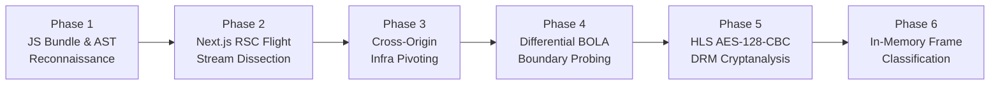

# 🔬 Security Assessment Methodology (6-Phase Grey/Black-Box Protocol)

> **Alignment**: OWASP Web Security Testing Guide (WSTG v4.2) • OWASP API Security Top 10 (2023) • PTES (Penetration Testing Execution Standard)

---

## 1. Overview of the Assessment Approach

Modern single-page and hybrid server-rendered applications (such as **Next.js 14/15 App Router** backed by **Spring Boot 3.x** and cloud-native media pipelines) rarely expose their entire attack surface through traditional HTML spidering. A rigorous security assessment must combine **static client-bundle reverse engineering**, **protocol-level deserialization analysis (RSC Flight Streams)**, **differential authorization probing**, and **cryptographic stream inspection**.



---

## 2. Detailed Breakdown of the 6 Assessment Phases

### Phase 1: Passive Surface Enumeration & Turbopack JS Chunk Dissection
**Objective**: Map every hidden API route, internal microservice hostname, and client-side cryptographic primitive without triggering WAF rate limits.
- **Sitemap & Route Discovery**: Enumerated `sitemap.xml` and `robots.txt` to identify 88 public and semi-protected application routes (`/vi/khoa-hoc/{id}`, `/vi/thu-vien/{slug}`, `/vi/gian-sach/{slug}`).
- **Lazy-Loaded Chunk Harvesting**: Extracted all script references from initial SSR HTML responses as well as lazy-loaded chunk manifests (`/_next/static/chunks/*.js`, 72+ bundles).
- **Static Pattern Extraction**:
  - Scanned JavaScript AST/bundles for API path templates (`/api/shaka/status/${id}`, `/api/shaka/token`, `/api/documents/${id}/file`, `/api/free-classes/${classId}/media/${metaId}/...`).
  - Identified Next.js Server Action hashes (`Next-Action` headers) and their corresponding server function names (`fetchProvinces3Level`, etc.).
  - Located a custom pure-JavaScript WebCrypto polyfill (`installCryptoPolyfill()` in player bundle `3mm1u1j08gl9l.js`) implementing raw `AES-CBC` and `SHA-256` for `window.crypto.subtle.decrypt`.

### Phase 2: React Server Components (RSC) Flight Stream Interception
**Objective**: Extract raw server-side component props serialized by Next.js App Router before client-side UI filtering occurs.
- **Protocol Mechanism**: By sending HTTP `GET` requests with the header `RSC: 1` (and optional `Next-Router-State-Tree`), Next.js returns the raw **React Flight serialization stream** (`text/x-component`) instead of rendered HTML.
- **Over-Posting & Hidden State Discovery**:
  - Even when the frontend UI displayed a placeholder banner (*"Feature under development"*) or hid locked syllabus items behind a login modal, the underlying RSC Flight payload serialized the **complete JSON object graph** directly from the backend database.
  - Uncovered **310 curriculum node UUIDs** across 9 courses, **18 unannounced book records** in `"status": "DRAFT"`, and **sequentially seeded database migration UUIDs** (`a0000000-0000-0000-0000-000000000001`, `a1000000-...`, `c1000000-...`).

### Phase 3: Cross-Origin Infrastructure Pivoting
**Objective**: Identify upstream microservices and object storage buckets that trust requests originating from the browser or lack perimeter authentication.
- **Host Extraction**: From the video player chunk (`2tv67cm3-xz1_.js`), extracted three distinct external infrastructure domains:
  1. `shaka.media-core.example` — Upstream video upload, FFmpeg/Shaka Packager transcoding, and key management API.
  2. `media.storage-edge.example` — JWT-gated HLS delivery proxy.
  3. `r2.storage-edge.example` — Underlying Cloudflare R2 object storage bucket.
- **Direct Upstream Probing**: Tested whether the upstream `shaka` and `r2` services enforced authentication independently of the primary `lms` backend.

### Phase 4: Differential Authorization Boundary & BOLA Probing
**Objective**: Systematically test every discovered REST endpoint across authentication states (`Unauthenticated`, `Student JWT`, `Invalid UUID`, `Valid UUID`) to construct an **Authorization Boundary Matrix**.
- **Sibling Endpoint Discrepancy**:
  - Probing `GET /api/shaka/token?videoId={uuid}` returned `HTTP 401 Unauthorized` (`{"error": "Authentication required"}`).
  - Probing its sibling endpoint `GET /api/shaka/status/{uuid}` returned **`HTTP 200 OK`**, leaking the complete Shaka job record including `"encryptionKey"` (Base64-encoded 16-byte AES-128 key) and `"encryptionKeyId"` (Hex-encoded 16-byte IV).
- **Direct Object Reference (BOLA / IDOR) Verification**:
  - Tested `GET /api/documents/{uuid}/file` across all active library UUIDs and historical UUIDs replaced by administrators. Confirmed that the endpoint streamed raw PDF binaries (`%PDF-1.4` / `%PDF-1.7`) without verifying authentication or publication status.
  - Tested `GET /api/book-orders/{uuid}/check-payment` and `GET /api/course-orders/installments/{uuid}/check-payment`, confirming that requests bypassed `JwtAuthenticationFilter` (`PermitAll`) and queried the database directly.

### Phase 5: Cryptographic HLS DRM Analysis & In-Memory Key Injection
**Objective**: Validate whether the leaked `encryptionKey` and `encryptionKeyId` values can decrypt the raw 1080p HLS streams stored on `r2.storage-edge.example`.
- **Playlist Dissection**: Fetched `https://r2.storage-edge.example/hls/{videoId}/video_1080p.m3u8` directly without a JWT. Inspected the `#EXT-X-KEY` tag:
  ```m3u8
  #EXT-X-KEY:METHOD=AES-128,URI="https://shaka.media-core.example/api/keys/{videoId}",IV=0x6a98f2160204d7b03603c8aa79416ff5
  ```
- **Cryptographic Verification**:
  - Decoded the Base64 `encryptionKey` into a 16-byte raw key $K \in \{0,1\}^{128}$ and parsed the 32-character hex `encryptionKeyId` into a 16-byte initialization vector $IV \in \{0,1\}^{128}$.
  - Verified that $\text{AES-128-CBC\_Decrypt}(K, IV, C_0)$ on the first segment (`seg_1080p_w0_0000.ts`) yields valid PKCS#7 padding and begins with the canonical MPEG-TS sync byte `0x47` (`G`) repeating every 188 bytes.

### Phase 6: Single-Segment Frame Extraction for Automated Classification
**Objective**: Prove full impact on unlabeled media records (`*_edubit.mp4`, `Record_*.mp4`) with minimal bandwidth footprint.
- Instead of downloading multi-gigabyte video streams, fetched a single ~400 KB segment (`seg_720p_w0_0005.ts`) in memory, decrypted it via AES-128-CBC, decoded the first I-frame using `PyAV`, and extracted the instructor's slide header to classify all 312 videos with 100% accuracy.

---

## 3. Mapping to Industry Frameworks

| Assessment Phase | OWASP WSTG v4.2 Control | OWASP API Security Top 10 (2023) | MITRE ATT&CK® Technique |
| :--- | :--- | :--- | :--- |
| **Phase 1: JS Chunk Recon** | `WSTG-INFO-05` (Review Webpage Content for Information Leakage) | `API9:2023` (Improper Inventory Management) | `T1592` (Gather Victim Host Information) |
| **Phase 2: RSC Flight Dissection** | `WSTG-CONF-05` (Enumerate Infrastructure and Application Admin Interfaces) | `API3:2023` (Broken Object Property Level Authorization) | `T1213` (Data from Information Repositories) |
| **Phase 3: Infra Pivoting** | `WSTG-INFO-04` (Enumerate Applications on Webserver) | `API8:2023` (Security Misconfiguration) | `T1590` (Gather Victim Network Information) |
| **Phase 4: Differential BOLA** | `WSTG-ATHZ-04` (Testing for Insecure Direct Object References) | `API1:2023` (Broken Object Level Authorization) | `T1190` (Exploit Public-Facing Application) |
| **Phase 5: HLS DRM Bypass** | `WSTG-CRYP-04` (Testing for Weak Encryption) | `API2:2023` (Broken Authentication) | `T1600` (Weaken Encryption) |
