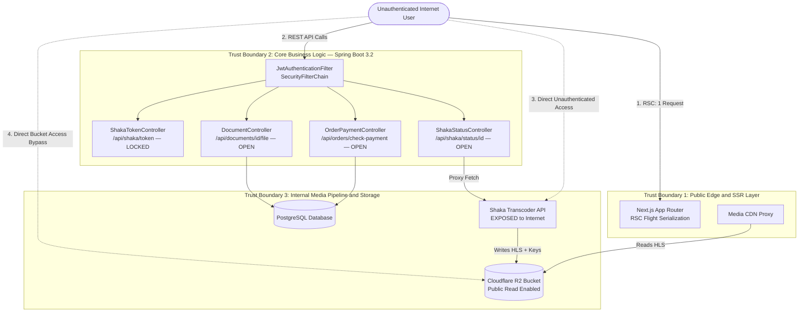

# 🎯 Architectural Threat Model (STRIDE & Trust Boundary Analysis)

> **Scope**: Multi-Tier EdTech LMS, Video Transcoding Cluster, and Edge Object Storage
> **Methodology**: Microsoft STRIDE + Data Flow Diagram (DFD) Trust Boundary Decomposition

---

## 1. System Architecture & Trust Boundaries

The target platform is composed of four distinct runtime tiers operating across separate subdomains:

1. **Tier 1 — Client Browser & Next.js App Router SSR (`lms.edtech-target.example`)**:
   - Serves React Server Components (RSC) and client-side Turbopack bundles.
   - Executes HLS.js media playback and a custom WebCrypto `AES-CBC` polyfill.
2. **Tier 2 — Core LMS Backend (`lms.edtech-target.example/api/*`)**:
   - Spring Boot 3.2 REST API backed by PostgreSQL.
   - Manages user authentication (JWT), course enrollments, library documents, book orders, and proxies status checks to the Shaka cluster.
3. **Tier 3 — Media Transcoding & DRM Key Server (`shaka.media-core.example`)**:
   - Node.js / Go microservice orchestrating FFmpeg & Shaka Packager.
   - Generates random 16-byte `AES-128` keys and IVs, packages `.mp4` uploads into multi-bitrate HLS (`.m3u8` + `.ts`), and pushes artifacts to Cloudflare R2.
4. **Tier 4 — Media Delivery Proxy (`media.storage-edge.example`) & Object Storage (`r2.storage-edge.example`)**:
   - `media.storage-edge.example` is a Cloudflare Worker / Reverse Proxy that validates a `?token=` JWT before serving HLS manifests.
   - `r2.storage-edge.example` is the underlying Cloudflare R2 storage bucket holding all encrypted `.ts` segments, `.m3u8` playlists, and lecture PDFs.

---

## 2. Broken Security Assumptions (Root-Cause Analysis)

During architectural design, the engineering team relied on four critical assumptions—all of which failed in production:

| # | Architectural Assumption | Reality Discovered During Assessment | Security Consequence |
| :-: | :--- | :--- | :--- |
| **A1** | *"Users cannot play HLS videos without a JWT from `GET /api/shaka/token`."* | While `/api/shaka/token` required auth (`401`), `/api/shaka/status/{id}` on the LMS and `/api/media` + `/api/auth/token` on `shaka.media-core.example` were left completely unauthenticated (`200 OK`). | Complete bypass of playback token gating; 100% of AES-128 keys and IVs are publicly readable. |
| **A2** | *"HLS segments are protected by `media.storage-edge.example` JWT validation."* | The underlying Cloudflare R2 bucket (`r2.storage-edge.example`) had **Public Bucket Access** enabled on `/hls/**` and `/lectures/pdf/**`. | Attackers can bypass `media.storage-edge.example` entirely and stream `1080p` `.m3u8` and `.ts` files directly from `r2`. |
| **A3** | *"UUIDv4 identifiers cannot be guessed, so unauthenticated endpoints using UUIDs are safe."* | Upstream `/api/media` dumped all 312 video UUIDs; RSC Flight streams leaked 310 course node UUIDs; database migrations used predictable sequential UUIDs (`a0000000-...`). | Security-by-obscurity collapsed; every UUID across the platform was enumerable. |
| **A4** | *"Hiding unfinished features (`DRAFT` books) or syllabus trees in React UI components prevents data exposure."* | Next.js RSC serializes the entire server-side data props into the Flight stream before the client component decides what to render. | Unauthenticated users querying `RSC: 1` retrieve internal `DRAFT` records and full curriculum trees. |

---

## 3. STRIDE Threat Matrix

| STRIDE Category | Threatened Component | Vulnerability Mechanism | Impact Rating | Associated Finding |
| :--- | :--- | :--- | :---: | :---: |
| **S — Spoofing** | `shaka.media-core.example` (`/api/auth/token`) | Anonymous endpoint mints valid `HS256` playback JWTs (`sub: "playback"`) without verifying caller identity. | **CRITICAL** | [`FIND-01`](./findings.md#find-01) |
| **T — Tampering** | `shaka.media-core.example` (`POST /api/upload/init`) | Unauthenticated users can initialize chunked uploads (`10 MB` chunks) and push arbitrary media into the transcoding pipeline. | **HIGH** | [`FIND-03`](./findings.md#find-03) |
| **R — Repudiation** | `/api/documents/{id}/file` & `r2.storage-edge.example` | Direct unauthenticated downloads from R2 and `PermitAll` endpoints generate no user-attributed audit logs. | **MEDIUM** | [`FIND-02`](./findings.md#find-02) |
| **I — Information Disclosure** | `/api/media`, `/api/shaka/status/{id}`, Next.js RSC Flight Stream | Leaks all 312 video titles, AES-128 keys, IVs, 18 `DRAFT` books, and 310 course syllabus nodes. | **CRITICAL** | [`FIND-01`](./findings.md#find-01) [`FIND-06`](./findings.md#find-06) |
| **D — Denial of Service** | `POST /api/upload/{id}/chunk` & `/complete` | Triggering concurrent 1080p FFmpeg + Shaka Packager jobs exhausts CPU, disk I/O, and R2 storage quota. | **HIGH** | [`FIND-03`](./findings.md#find-03) |
| **E — Elevation of Privilege** | Paid Courses & Restricted Library PDFs | Anonymous visitors gain full access to paid course videos (2K9, 2K10, 2K11) and deleted/replaced PDFs without enrollment. | **CRITICAL** | [`FIND-01`](./findings.md#find-01) [`FIND-04`](./findings.md#find-04) |
